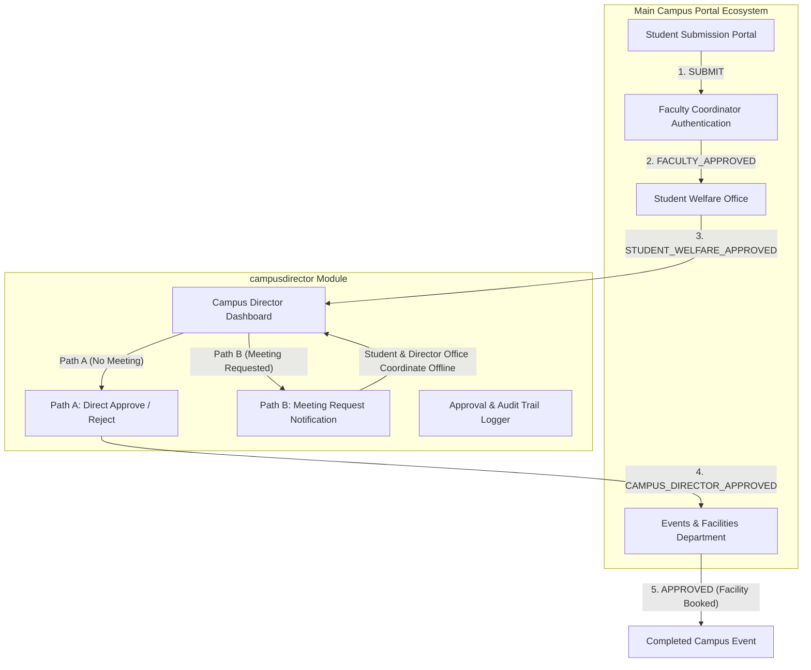

# Enterprise Integration Guide & Architecture Blueprint
## Component: `campusdirector` (Optional Campus Director Review & Meeting Workflow)

This document provides a comprehensive integration blueprint for embedding the **Campus Director Meeting & Event Approval Module** (`campusdirector`) into the broader Amrita Vishwa Vidyapeetham Campus Facility & Event Coordination Portal ecosystem.

---

## 1. Architectural Big Picture & Domain Boundaries

The `campusdirector` module is designed as a pluggable, decoupled domain service responsible for handling executive escalation, meeting requests, and approval gating for campus events.



### Domain Boundaries
- **Core Portal Responsibilities**: Event proposal drafting, initial venue reservation, budget tracking, student welfare checks, final facility key issuance.
- **`campusdirector` Component Responsibilities**: Executive discretion review, Path A (direct approval/rejection without meeting), Path B (meeting request notifications to student coordinators), clarification returns, and approval audit logs.

---

## 2. Integration Architectures

### Option A: Monolithic FastAPI Integration (Shared Database & Process)
Mount the `campusdirector` backend router and models directly into the main portal's unified FastAPI application.

#### 1. Router Mount Code (`main.py`)
```python
from fastapi import FastAPI
from backend.app.routers import events as director_events
from backend.app.routers import notifications as portal_notifs

app = FastAPI(title="Amrita Main Campus Portal")

# Include Campus Director Review Workflow Router
app.include_router(director_events.router, prefix="/api", tags=["Campus Director Workflow"])
app.include_router(portal_notifs.router, prefix="/api", tags=["Notifications"])
```

#### 2. Database Model Merging (`models.py`)
Import the `EventRequest`, `ApprovalLog`, and `Notification` models into the core portal's SQLAlchemy metadata registry.

```python
from sqlalchemy.orm import declarative_base
Base = declarative_base()

# Shared User table
from backend.app.models import User, EventRequest, ApprovalLog, Notification
```

---

### Option B: Microservice / API Gateway Integration
Run `campusdirector` as an independent microservice on port `8000` behind an enterprise API Gateway (e.g., NGINX, Kong, or Traefik).

```text
Client Browser / SPA  --->  API Gateway (https://portal.amrita.edu)
                                ├── /api/v1/core/*       ---> Core Portal Service (Port 8080)
                                ├── /api/v1/director/*   ---> campusdirector Service (Port 8000)
                                └── /api/v1/booking/*    ---> studentlimitedseatsbooking Service (Port 8001)
```

---

## 3. Shared Identity & Data Schemas Contract

### 3.1 User Roles & RBAC Contract
The main portal must pass authenticated user identity headers (`X-User-Id`, `X-User-Role`) or JWT tokens matching the standard roles:

| Role Name | Description | Authorizations in `campusdirector` |
| :--- | :--- | :--- |
| `STUDENT` | Student Event Coordinator | Submits proposals, receives meeting request notifications |
| `FACULTY_COORDINATOR` | Faculty Advisor | Authenticates and approves student proposals |
| `STUDENT_WELFARE` | Dean of Student Welfare | Conducts welfare & safety checks |
| `CAMPUS_DIRECTOR` | Executive Director | Direct Approve/Reject, Request Meeting, Return for Clarification |
| `DIRECTOR_OFFICE` | Executive Assistant / Office | Acts on behalf of Director for reviews & notifications |
| `EVENTS_DEPARTMENT` | Facilities Office | Final facility booking confirmation |

### 3.2 Event Request Workflow States

```text
[SUBMITTED] 
    ↓ (Faculty Approve)
[FACULTY_APPROVED] 
    ↓ (Student Welfare Approve)
[STUDENT_WELFARE_APPROVED] 
    ↓ (Reaches Campus Director)
    ├─────────────────────────────────────────┐
    │ Path A: Direct Decision                 │ Path B: Meeting Requested
    ▼                                         ▼
[CAMPUS_DIRECTOR_APPROVED] / [REJECTED]   [MEETING_REQUESTED]
    ↓                                         ↓ (Offline Meeting + Director Decision)
[EVENTS_DEPARTMENT] (Final Approve)        [CAMPUS_DIRECTOR_APPROVED] / [RETURNED_FOR_CLARIFICATION]
    ↓
[APPROVED] (Completed)
```

---

## 4. API Endpoints Reference

### 4.1 Workflow Execution Endpoints

#### `POST /api/events/{event_id}/welfare-approve`
Forward request from Student Welfare to Campus Director.
```json
{
  "actor_id": "welfare_dean",
  "action": "APPROVE",
  "comments": "Approved. Welfare and safety criteria satisfied."
}
```

#### `POST /api/events/{event_id}/director-direct-decision` (Path A)
Director makes decision directly without a meeting.
```json
{
  "actor_id": "director_johnson",
  "action": "APPROVE", // or "REJECT", "RETURN_FOR_CLARIFICATION"
  "comments": "Approved directly. Proposal is well prepared."
}
```

#### `POST /api/events/{event_id}/director-request-meeting` (Path B)
Director requests a meeting. Sets status to `MEETING_REQUESTED` and notifies student.
```json
{
  "actor_id": "director_johnson",
  "comments": "Please meet with the Director's Office to discuss budget & security."
}
```

---

## 5. Webhook & Notification Hooks

When `director_request_meeting` is invoked, the component automatically creates a `Notification` payload:

```json
{
  "user_id": "student_alice",
  "title": "Meeting Requested by Campus Director",
  "message": "Campus Director requested a meeting regarding 'Annual Tech Symposium & Hackathon 2026'. Please contact the Director's Office to figure out when and how to meet.",
  "notification_type": "MEETING_REQUESTED",
  "related_event_id": 1
}
```

Integrate this payload with your institutional SMTP/SendGrid or push notification engine.
