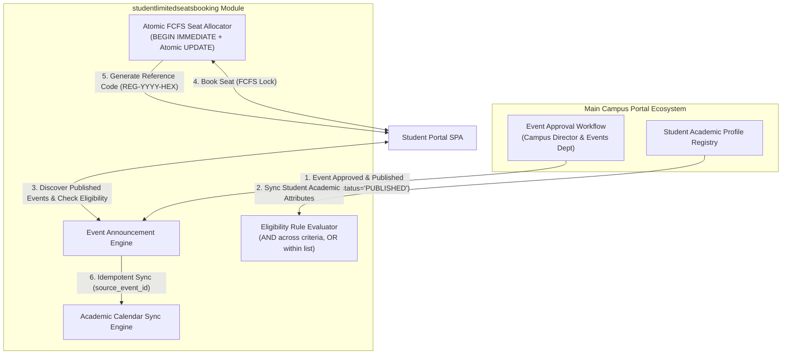

# Enterprise Integration Guide & Architecture Blueprint
## Component: `studentlimitedseatsbooking` (Student Discovery, FCFS Seat Booking & Academic Calendar)

This document provides a comprehensive integration blueprint for embedding the **Student Limited-Seat Booking, Multi-Condition Eligibility & Academic Calendar Component** (`studentlimitedseatsbooking`) into the broader Amrita Vishwa Vidyapeetham Campus Portal ecosystem.

---

## 1. Architectural Big Picture & Domain Boundaries

The `studentlimitedseatsbooking` module is designed as an isolated, high-performance domain component responsible for student-facing event discovery, eligibility rule evaluation, server-side First-Come-First-Served (FCFS) atomic seat reservations, student dashboard isolation, and institutional Academic Calendar synchronization.



### Domain Boundaries
- **Core Portal Responsibilities**: Event creation by departments, budget approval, faculty authentication, Campus Director review, venue scheduling.
- **`studentlimitedseatsbooking` Component Responsibilities**: Public event discovery feed (published events only), multi-condition student eligibility verification, thread-safe FCFS seat booking with atomic SQL capacity decrement, seat cancellation, user-isolated registration dashboard, and Academic Calendar synchronization.

---

## 2. Integration Architectures

### Option A: Monolithic FastAPI Router Integration (Recommended for Unified Monolith)
Include the component's routers directly into the main portal's unified FastAPI application.

#### 1. Router Mount Code (`main.py`)
```python
from fastapi import FastAPI
from app.routes import events as student_events
from app.routes import registrations as student_bookings
from app.routes import calendar as academic_cal
from app.routes import admin as booking_admin

app = FastAPI(title="Amrita Main Campus Portal")

# Mount student limited seats booking component routers
app.include_router(student_events.router, prefix="/api", tags=["Student Discovery"])
app.include_router(student_bookings.router, prefix="/api", tags=["FCFS Seat Booking"])
app.include_router(academic_cal.router, prefix="/api", tags=["Academic Calendar"])
app.include_router(booking_admin.router, prefix="/api", tags=["Booking Admin"])
```

#### 2. Database Model Merging (`models.py`)
Import the `StudentProfile`, `Event`, `EligibilityRule`, `EventRegistration`, and `AcademicCalendarEntry` models into your central SQLAlchemy database registry.

---

### Option B: Standalone Microservice (Recommended for Microservices Architecture)
Run `studentlimitedseatsbooking` as an independent microservice on port `8001` behind an enterprise API Gateway.

```text
Client Browser / SPA  --->  API Gateway (https://portal.amrita.edu)
                                ├── /api/v1/core/*       ---> Core Portal Service (Port 8080)
                                ├── /api/v1/director/*   ---> campusdirector Service (Port 8000)
                                └── /api/v1/booking/*    ---> studentlimitedseatsbooking Service (Port 8001)
```

---

## 3. Shared Identity & Data Schemas Contract

### 3.1 Student Profile Mapping
The main portal's authentication provider or LDAP directory syncs student academic attributes into `student_profiles`:

| Attribute | Type | Description | Example |
| :--- | :--- | :--- | :--- |
| `id` | String | Unique Roll Number | `CB.EN.U4CSE22001` |
| `user_id` | String | Portal User Reference | `user_alice` |
| `full_name` | String | Student Full Name | `Alice Wang` |
| `email` | String | Institutional Email | `alice.wang@amrita.edu` |
| `programme` | String | Degree / Programme | `B.Tech` |
| `department` | String | Department | `Computer Science` |
| `current_academic_year` | Integer | Academic Year | `4` |
| `graduating_batch` | Integer | Batch Year | `2025` |
| `verification_status` | String | Status | `VERIFIED` |

### 3.2 Multi-Condition Eligibility Rule Schema
Configured via `POST /api/admin/events/{event_id}/eligibility`:

```json
{
  "is_open_to_all": false,
  "allowed_programmes": ["B.Tech", "Integrated MSc Data Science"],
  "allowed_departments": ["Computer Science", "Data Science"],
  "allowed_academic_years": [3, 4],
  "allowed_batches": [2025, 2026]
}
```

- **Rule Logic**: Evaluates **OR** within the same list (e.g. `B.Tech` OR `Integrated MSc Data Science`), and **AND** across different criteria.
- **Ineligible Explanation**: Returns plain-language descriptions detailing exact unmatched attributes (e.g. `Your current academic profile does not meet these requirements: degree/programme (Integrated MSc Data Science vs allowed: B.Tech); academic year (Your profile: Year 2 vs allowed: Year 4)`).

---

## 4. Concurrency & FCFS Seat Allocation Engine

### Atomic SQL Decrement Query
To eliminate race conditions and overbooking across parallel requests:

```python
updated_rows = db.query(Event).filter(
    Event.id == event.id,
    Event.remaining_seats > 0
).update(
    {Event.remaining_seats: Event.remaining_seats - 1},
    synchronize_session=False
)
if updated_rows == 0:
    raise HTTPException(
        status_code=status.HTTP_409_CONFLICT,
        detail="Registration Full: All available seats for this event have been claimed."
    )
```

---

## 5. API Endpoints Reference

### 5.1 FCFS Seat Booking Endpoint

#### `POST /api/registrations`
**Request**:
```json
{
  "student_profile_id": "CB.EN.U4CSE22001",
  "event_id": 1
}
```

**Response (Success - 200 OK)**:
```json
{
  "id": 42,
  "event_id": 1,
  "student_profile_id": "CB.EN.U4CSE22001",
  "registration_reference": "REG-2025-9A8C1F",
  "registration_status": "CONFIRMED",
  "registration_timestamp": "2026-10-11T03:00:00Z"
}
```

**Response (Conflict - 409 Conflict)**:
```json
{
  "detail": "Registration Full: All available seats for this event have been claimed."
}
```

### 5.2 Seat Cancellation Endpoint

#### `POST /api/registrations/{registration_id}/cancel?student_id=CB.EN.U4CSE22001`
Cancels booking, releases the claimed seat back to `remaining_seats`, and updates event status.

---

## 6. Academic Calendar Synchronization Contract

Synchronization to `academic_calendar_entries` is idempotent and triggered automatically when:
1. An event is created or published (`publication_status = 'PUBLISHED'`).
2. An event details or schedule is updated.
3. Event capacity status changes (`REGISTRATION_FULL`).
4. An event is cancelled.

Idempotency guarantee: Keyed on `source_event_id`, ensuring re-syncing updates existing calendar records without creating duplicate rows.
